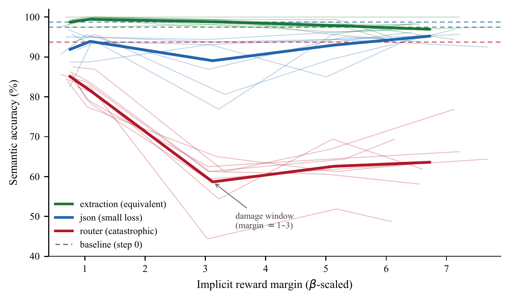
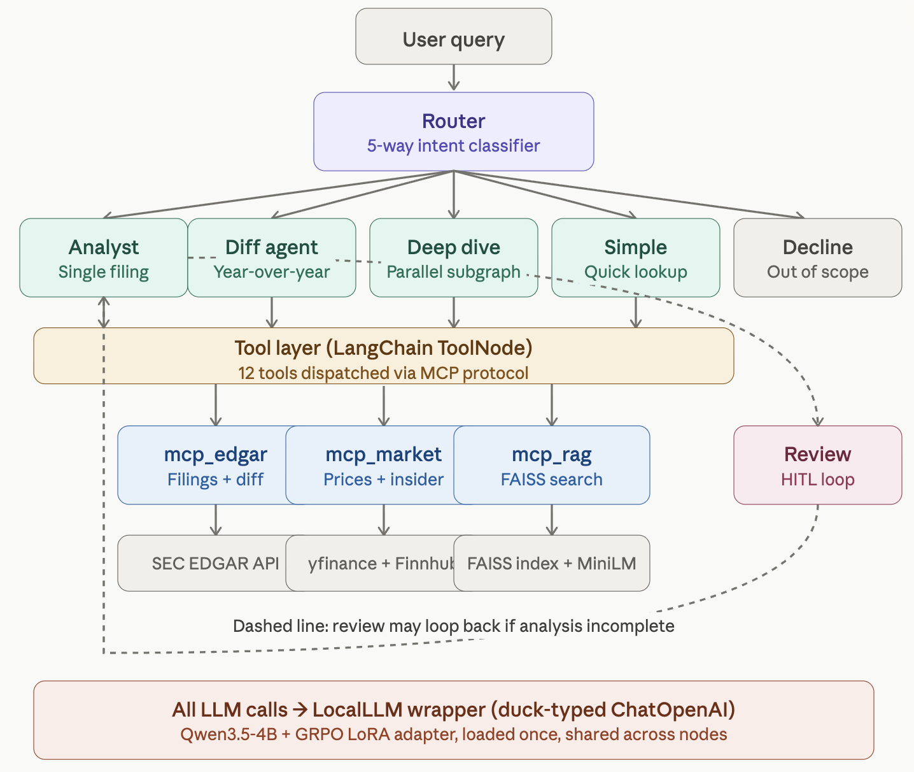

# Delta Filing

Code and data of the paper *The Alignment Tax Is Graded* (arXiv:2611.06476), and the SEC filing agent system the study grew out of.

[](https://arxiv.org/abs/2611.06476)
[](LICENSE)

| What is here | |
|---|---|
| [Paper](#paper) | Pre-registered study of capability loss under length-normalized DPO with SFT retention: code, data, adapters, analyses. File map in [docs/PAPER_MAP.md](docs/PAPER_MAP.md) |
| [Agent system](#agent-system) | LangGraph multi-agent SEC filing analyst with on-device Qwen3.5-4B + LoRA and MCP tool servers. Details in [docs/SYSTEM.md](docs/SYSTEM.md) |
| [Earlier ablation](#earlier-ablation) | Single-seed comparison of five alignment methods on a custom 87-test suite. Full write-up in [docs/ABLATION.md](docs/ABLATION.md) |

## Paper

**The Alignment Tax Is Graded: Task-Selective Capability Loss Under Length-Normalized DPO with SFT Retention**
Ye Yuan. arXiv:2611.06476 [cs.LG], 2026. <https://arxiv.org/abs/2611.06476>

- **Results:** extraction is preserved (Δ = −0.55 pts, equivalent at ±5 pts); json shows a small loss (Δ = −3.52 pts, equivalence not shown); router shows a severe loss (Δ = −30 pts, not equivalent).
- **Design:** Qwen3.5-4B, sparse LoRA, length-normalized DPO with an SFT retention term; 8 seeds, 6 of them unseen at freeze; pre-registered, with TOST equivalence testing.
- **Scope:** one 4B model, sparse LoRA on 8/32 layers, easily-separable synthetic preferences, three structured tasks.



*Paper Figure 1, generated by [`scripts/make_figures.py`](scripts/make_figures.py).*

```bibtex
@misc{yuan2026alignmenttaxgradedtaskselective,
      title={The Alignment Tax Is Graded: Task-Selective Capability Loss Under Length-Normalized DPO with SFT Retention},
      author={Ye Yuan},
      year={2026},
      eprint={2611.06476},
      archivePrefix={arXiv},
      primaryClass={cs.LG},
      url={https://arxiv.org/abs/2611.06476},
}
```

Known corrections to the paper are listed in [ERRATA.md](ERRATA.md).

### Paper map

| Component | Main entry |
|---|---|
| Protocol | [`notes/2026-06-18_note2_matrix_prereg_FROZEN.md`](notes/2026-06-18_note2_matrix_prereg_FROZEN.md) (Note 2, frozen) |
| Training | [`train_pref.py`](train_pref.py), run by [`run_matrix.py`](run_matrix.py) |
| Scoring | [`scorer_v2.py`](scorer_v2.py) |
| Suites | [`data_eval/`](data_eval/) |
| Adapters | [`kaggle_result/final/`](kaggle_result/final/) |
| Analyses | [`primary_analysis.py`](primary_analysis.py) (primary TOST) |
| Figures | [`scripts/make_figures.py`](scripts/make_figures.py) |

Full paper-to-file map, with notes on specific files: [docs/PAPER_MAP.md](docs/PAPER_MAP.md).

### Versioning

Each git tag marks a state of the code and data that an arXiv version reports. [`paper-v1`](https://github.com/yuan-phd/delta-filing/tree/paper-v1) is the state at submission of arXiv v1. arXiv v2, v3 and v4 change only the Acknowledgements and the author's email address. [`paper-v2`](https://github.com/yuan-phd/delta-filing/tree/paper-v2) adds only documentation and reproducibility files to `paper-v1`, with identical code, data, adapters and results. v3 and v4 have no tags of their own because nothing in the repository changed for them. arXiv v4 is the current version.

A new tag is created only when an arXiv version changes code, data or results. Corrections found after a release are logged in [ERRATA.md](ERRATA.md) and applied in a later arXiv version. Tagged states and the history of `main` are never silently rewritten.

## Agent system

A SEC filing intelligence system built as a **multi-agent orchestrator with on-device LLM inference**. A LangGraph state machine routes queries such as *"How did Tesla's risk disclosures change from 2023 to 2024?"* to specialized agents that retrieve SEC filings through MCP tools, add market data, news and insider trades, and write an analytical summary with references to filing sections. A human-in-the-loop reviewer can pause the analysis and ask for more depth. Every LLM call goes through one local Qwen3.5-4B + LoRA instance (`local_llm.py`, a drop-in for `ChatOpenAI`), so the agent makes no OpenAI calls. Details: [docs/SYSTEM.md](docs/SYSTEM.md).



| Node | Path | Behavior |
|------|------|----------|
| `analyst` | FILING_ANALYSIS | Loops with tool calls until enough EDGAR data retrieved; then synthesizes |
| `diff_agent` | FILING_DIFF | Calls `diff_filing_sections` tool, narrates the year-over-year changes |
| `company_deep_dive` | COMPANY_DEEP_DIVE | **Subgraph**: parallel `financial` / `news` / `insider` nodes fan out, then `synthesis` agent merges |
| `simple` | SIMPLE_QUERY | Quick lookup or short answer |
| `decline` | OUT_OF_SCOPE | Returns a fixed "out of scope" message, no LLM call |

Twelve tools are exposed by **three independent MCP servers**:

| MCP Server | Tools | Backend |
|------------|-------|---------|
| `mcp_edgar` | `search_filings`, `get_filing_section`, `diff_filing_sections` | SEC EDGAR API + local cache |
| `mcp_market` | `stock_price`, `company_metrics`, `company_news`, `insider_trades`, `analyst_ratings`, `compare_stock_performance` | yfinance, Finnhub |
| `mcp_rag` | `search_similar_sections`, `search_company_sections`, `index_stats` | FAISS index over fine-tuned MiniLM embeddings |

`app.py` connects to `mcp_edgar`; the deep-dive's financial, news and insider nodes call `market.py` directly. `mcp_market` and `mcp_rag` run as standalone MCP servers and are not connected in `app.py`.

### Quick start

```bash
pip install -r requirements.txt

# API keys: FINNHUB_API_KEY (news, insider trades, analyst ratings) and FRED_API_KEY go in .env
cp .env.example .env
# Edit .env. SEC EDGAR needs no key, but set the User-Agent in edgar.py to your own contact.
# OPENAI_API_KEY in .env.example is legacy and not required.

# Optional: build the RAG index used by mcp_rag.py (one-time, ~1 minute)
python generate_embedding_data.py
python train_embedding.py --train      # ~5 min on CPU/MPS
python build_index_from_sft.py         # ~1 min

# Run the agent (downloads Qwen/Qwen3.5-4B, loads adapters/grpo_v2)
python app.py
```

**Hardware and speed:** `local_llm.py` runs on Apple MPS, CUDA or CPU. Inference runs at ~5.6 tokens/sec on M1 Max MPS. Typical query latency: 30 seconds for routing, 1–3 minutes for a full multi-source analysis.

### Performance and limitations

- **Inference speed**: 5.6 tokens/sec on M1 Max MPS (flash-attention not available for Qwen3.5 on Apple Silicon). On A100 the same model runs at ~80 tok/s; via llama.cpp + GGUF on M1 Max, ~30–40 tok/s. The trained adapter is identical; only inference is slow.
- **Tool role gap**: SFT training data has no `tool`-role messages. The wrapper handles this with a `[Tool result]` prefix on user turns. It works in practice but is not the cleanest design.

## Earlier ablation

> **Note:** This ablation is a separate, earlier experiment from the paper. It used a different trainer and objective setup, a custom 87-test suite and a single seed. Its observations (including "Observation 1" below) are not the paper's results and are not superseded or confirmed by them. The paper studies length-normalized DPO with an assistant-only SFT retention term over 8 seeds with pre-registered TOST equivalence testing; its code and data are tagged `paper-v1`.

Five alignment methods, LoRA (rank 8) on Qwen3.5-4B, scored on a custom 87-test suite:

| Adapter | Method | Final score | Notes |
|---------|--------|-------------|-------|
| SFT | Supervised cross-entropy | 73/87 (84%) | Baseline |
| DPO | `-logσ(β·margin)` | 65/87 (75%) | Unbounded margin; Review 1/9 |
| IPO | `(margin - 1/(2β))²` | 70/87 (80%) | Bounded margin via identity loss |
| cDPO | `-(1-ε)·logσ(m) - ε·logσ(-m)` | 69/87 (79%) | Label smoothing |
| **GRPO** | RL with k3 KL estimator | **76/87 (87%)** ★ | Used by the agent in this repository |

These results come from one seed and 87 tests and are stated as observations:

- **Observation 1:** with identical data and hyperparameters, the unbounded DPO objective showed the largest capability loss in this run (margin 0.02 → 8.76; Review 1/9 while Tool parsing stayed 8/8), and the bounded IPO and smoothed cDPO showed less.
- **Observation 2:** the first GRPO run used the log-ratio as KL, which went negative (down to −0.8945) and scored 66/87; with the k3 estimator, the same setup scored 76/87.
- **Observation 3:** alarm-word counts on healthy companies showed cDPO at about 2× SFT (7.3 vs 4.0), a difference binary pass/fail at ≤3 alarm words did not show.
- **Single-seed results:** GRPO_v2's +10 over the buggy GRPO v1, and its lead over SFT, come from a single seed. Multi-seed runs would bound the variance estimate.

Full results, per-category table, the 87-test suite and further limitations: [docs/ABLATION.md](docs/ABLATION.md).

## License

Everything in this repository is licensed under the [Apache License, Version 2.0](LICENSE): code, data (preference pairs, SFT data, evaluation suites), LoRA adapters and results.

See [NOTICE](NOTICE) for third-party terms and attributions: the Qwen3.5-4B base model (not redistributed here; its own license applies to the base model and to any model derived from it with these adapters), the OpenAI-generated data (OpenAI's terms also apply), SEC EDGAR filings (public records; no SEC affiliation), and vendored third-party code.

---

## Acknowledgments

- Base model: [Qwen/Qwen3.5-4B](https://huggingface.co/Qwen/Qwen3.5-4B)
- Embedding base: [sentence-transformers/all-MiniLM-L6-v2](https://huggingface.co/sentence-transformers/all-MiniLM-L6-v2)
- KL k3 estimator: [Schulman, "Approximating KL Divergence" (2020)](http://joschu.net/blog/kl-approx.html)
- IPO loss reference: [Azar et al., "A General Theoretical Paradigm to Understand Learning from Human Preferences" (2023)](https://arxiv.org/abs/2310.12036)
- GRPO reference: [DeepSeek-R1 paper](https://arxiv.org/abs/2501.12948)
- Training infrastructure: Kaggle T4 (free tier)
- Data source: SEC EDGAR

---

## Contact

Ye Yuan: yuan.phd.ai@gmail.com
